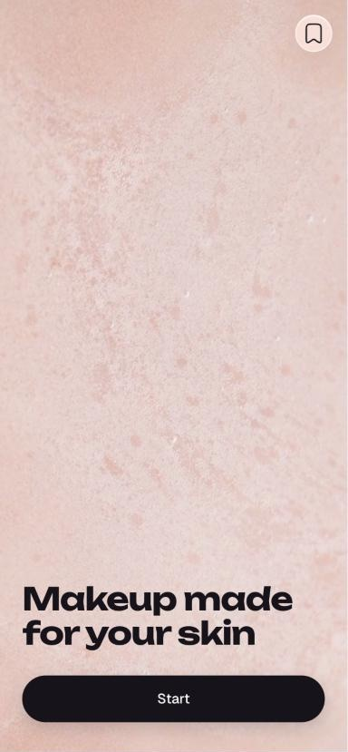
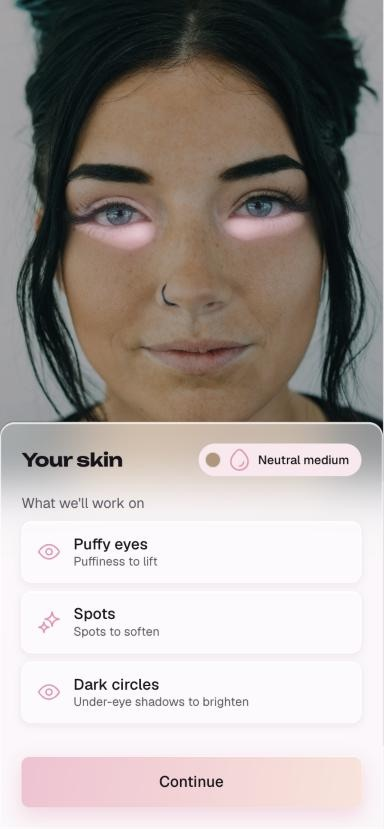
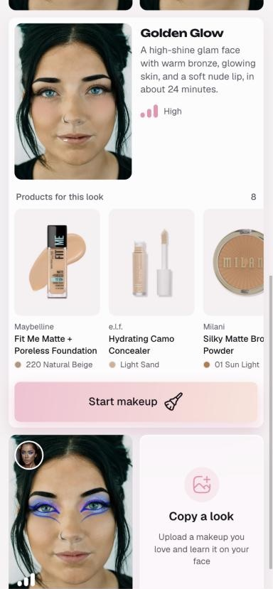
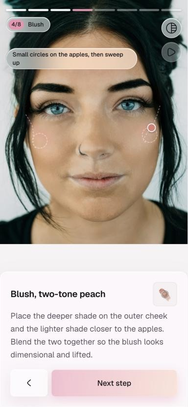
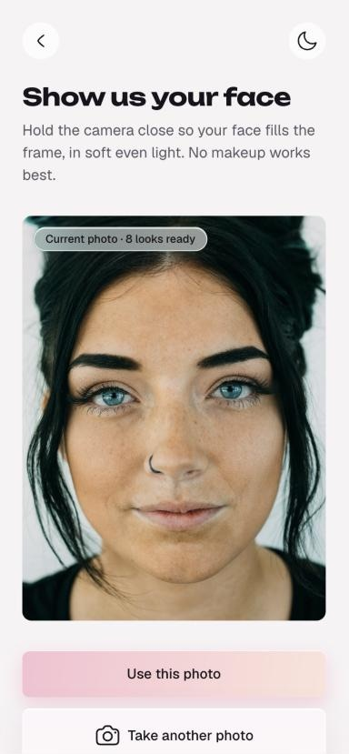
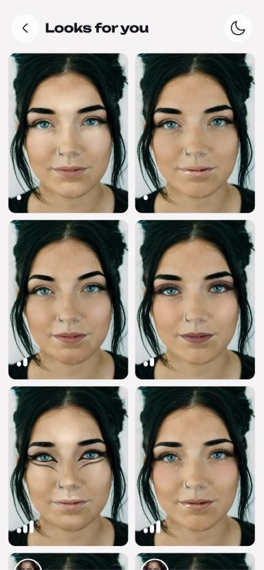
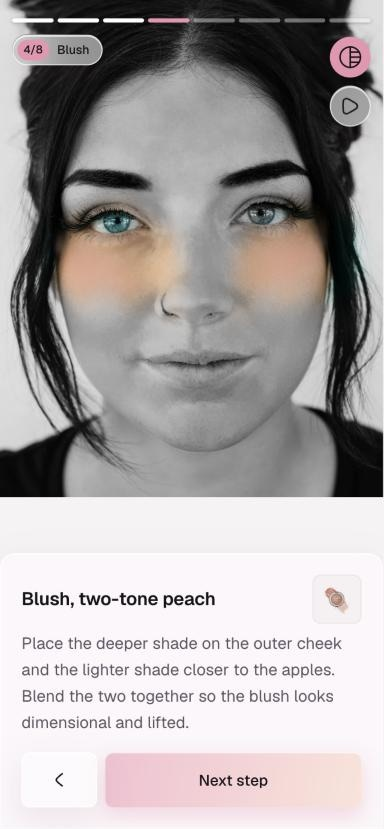
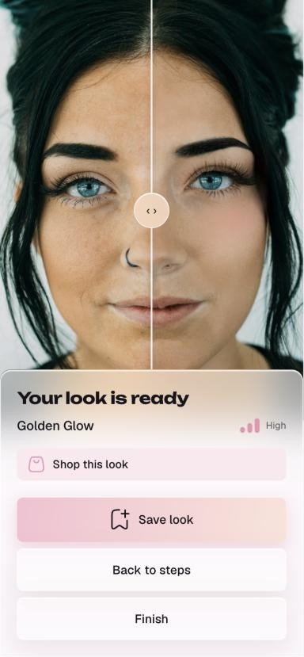
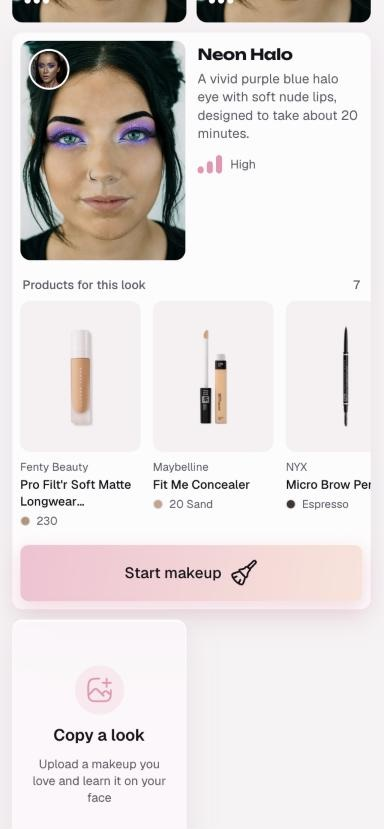
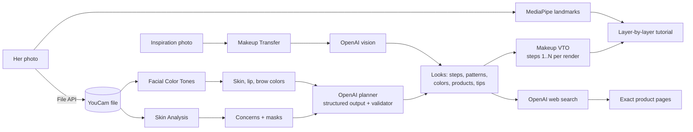

# GlowApp

**Makeup made for your skin, taught step by step on your own face.**

GlowApp reads your skin with YouCam Skin AI, designs six makeup looks that correct what it found, and teaches the one you pick layer by layer on *your own photo*. Each step shows your face with only the layers applied so far, a brush stroke showing where and how to apply it, the exact product and shade, and a tip written for your skin. Love a look you saw online? **Copy a look** turns any inspiration photo into a tutorial on your face.

Built for the [YouCam API Skin AI & eCommerce VTO Hackathon](https://youcam-api-skin-ai-ecommerce.devpost.com/), **Skin AI** track.

<p>
  
  
  
  
</p>

## The problem

Makeup tutorials are made for someone else's face. Videos show a model with different skin, a different tone and different concerns, and leave you to translate: *which concealer covers my dark circles? Where exactly does contour go on my face? Which shade is mine?* Shoppers buy products they then can't use, or never try a look because it seems too hard.

GlowApp meets that moment in front of the mirror. It reads **your skin**, plans looks that **correct what it found**, and shows every step **painted on your own face**, with the product to buy for each one.

## What it does

| | Feature | What she gets |
|---|---|---|
| 1 | **Skin read** | A photo becomes a list of points to work on (blemishes, redness, dark circles, spots, shine, puffy eyes). Tap one and that area glows on her face. Her skin, lip and brow colors are measured too. |
| 2 | **Six looks for her skin** | Two easy, two medium and two difficult, each previewed on her own face. Every look includes the steps that actually correct her points (concealer for dark circles, never eyebrows), in shades matched to her skin tone. |
| 3 | **Products, not guesswork** | Every step names a real product and shade (Maybelline, e.l.f., Fenty, NYX...). Each product's exact page at Sephora, Ulta, Target, Walmart or the brand is found by web search, with a photo of the product and an Amazon search alongside. |
| 4 | **Layer-by-layer tutorial** | Step N shows her face with steps 1 to N applied, so she sees exactly what each layer adds. Swipe, tap the step bar or use the arrow keys. |
| 5 | **How to apply** | A brush follows a hand-made stroke for that product on *her* face (circles on the apples for blush, ear toward mouth for contour, lash line then flick for liner) and paints the layer as it moves. |
| 6 | **Focus mode** | Turns her face grayscale except where this step's product goes. |
| 7 | **Copy a look** | She uploads any makeup photo; GlowApp transfers it onto her face and breaks it into the same kind of tutorial, with products and correction steps for her skin. |
| 8 | **Before / after and saved looks** | A slider compares bare and finished. Saved looks live on her device and replay offline without spending API units. |

<p>
  
  
  
  
  
</p>

## APIs used

### YouCam API (Perfect Corp)

All YouCam calls go through `lib/youcam/` from the server routes in `app/api/`, using the S2S v2.0 API (`https://yce-api-01.makeupar.com/s2s/v2.0`): upload a file, start a task, poll until it finishes.

| YouCam API | Endpoint | Used for | Units |
|---|---|---|---|
| [File API](https://docs.perfectcorp.com/develop/quick_start_guide) | `POST /file`, then upload | Uploads her photo once (and the inspiration photo for Copy a look) | 0 |
| [AI Skin Analysis](https://docs.perfectcorp.com/reference/description/ai_skin_analysis.md) | `task/skin-analysis` | Six concerns (acne, redness, dark circles, age spots, oiliness, eye bags) plus skin type, each with a mask GlowApp lights up on her face. The scores decide which concerns every look must correct | 12 |
| [AI Facial Color Tones](https://docs.perfectcorp.com/reference/description/ai_face_tone_analyzer.md) | `task/skin-tone-analysis` | Her skin, lip and brow colors, which foundation and concealer shades are matched to. Cached on the device, so it runs once | 20 |
| [AI Makeup Virtual Try-On](https://docs.perfectcorp.com/reference/description/ai_makeup_vto.md) | `task/makeup-vto` | Every look preview and every tutorial step (steps 1 to N painted cumulatively). 11 categories: foundation, concealer, contour, bronzer, blush, highlighter, eyebrows, eye shadow, eyeliner, lashes and lips, with patterns curated from YouCam's catalog | 1 per render |
| [AI Makeup Transfer](https://docs.perfectcorp.com/reference/ai_makeup_transfer) | `task/mu-transfer` | Copy a look: paints the inspiration photo's makeup onto her face, so the planner sees how its colors sit on her skin | 2 |

### Other services

| Service | Used for |
|---|---|
| [OpenAI Responses API](https://platform.openai.com/docs/api-reference/responses), model `gpt-5.4-mini` | Plans the six looks as strict JSON with [Structured Outputs](https://platform.openai.com/docs/guides/structured-outputs) (zod schema): steps, YouCam patterns, colors, intensity, finish, tip and a real product per step. A validator checks the plan (difficulty mix, every concern corrected by an honest category, real patterns, product type matching the step) and sends problems back for one retry |
| OpenAI [vision](https://platform.openai.com/docs/guides/images-vision) | Copy a look: reads the inspiration photo and the transfer result to rebuild the look as steps |
| OpenAI [web search tool](https://platform.openai.com/docs/guides/tools-web-search) | Finds each product's exact page at Sephora, Ulta, Target, Walmart or the brand. Every page is fetched before it's trusted, and its product photo is used |
| [MediaPipe Face Landmarker](https://ai.google.dev/edge/mediapipe/solutions/vision/face_landmarker) | Runs in the browser: 478 face points place the how-to-apply brush strokes on her cheekbones, lash line and lips |
| [Open Beauty Facts](https://world.openbeautyfacts.org/data) | Fallback product photos (CC BY-SA) |
| Amazon search links | A search for each product and shade, with an optional Associates tag |

## Try it in 2 minutes, no keys needed

The repo ships with recorded API responses (`fixtures/`), so the whole journey runs offline in **replay** mode and costs nothing.

```bash
npm install
npm run dev
```

1. Open http://localhost:3000 in your browser's phone view (DevTools, device toolbar). GlowApp is mobile-first.
2. Tap **Start**, then **Take a photo** and upload any photo. Replay always shows the recorded demo face (`fixtures/demo-face.jpg`) so the skin masks line up.
3. On **Your skin**, tap a concern to see it glow on the face, then **Continue**.
4. On **Looks for you**, tap a look to see its products, then **Start makeup**.
5. In the tutorial, walk the layers. Tap ▶ to see how to apply each step, and the contrast icon for focus mode.
6. On **Finish**, compare before and after, open **Shop this look**, then **Save look**. Reopen it from the bookmark on the welcome screen.
7. Back on **Looks for you**, tap **Copy a look** and upload `demo/copy-a-look-inspiration.jpg`. The recorded copy, "Neon Halo", joins the grid with its own tutorial.

Requires Node.js 20.9 or newer. If port 3000 is busy, run `npm run dev -- -p 3100`.

## Run it against the real APIs

```bash
cp .env.example .env
```

| Variable | What it does |
|---|---|
| `API_MODE` | `replay` (default): answers from `fixtures/`, no keys, 0 units. `live`: real calls. `record`: real calls, saved to `fixtures/` |
| `YOUCAM_API_KEY` | YouCam API key, from the [YouCam API console](https://yce.makeupar.com/api-console/en/api-keys/) |
| `OPENAI_API_KEY` | OpenAI key for the look planner, Copy a look and product search |
| `NEXT_PUBLIC_AMAZON_TAG` | Optional Amazon Associates tag added to the Amazon links |

- **Photos:** front-facing, soft even light, face filling the frame (YouCam needs the face wider than 60% of the photo). Photos are resized to 1600px before upload.
- **Timing:** the skin read takes about 10 seconds, the six looks about 20, and each layer about 12. Step 1 paints first while the rest follow.
- **Cost:** a first session uses about 44 YouCam units (12 skin analysis, 20 skin tone, 6 previews, about 6 tutorial layers). Later sessions skip the 20-unit tone call. A copied look adds 2 for the transfer plus its layers. Tasks YouCam rejects (no face, too dark) cost nothing.
- **Reuse:** her photo, skin read, looks and every render are kept on the device, so coming back to the same photo spends no units or tokens.

## How it works



- **Server routes** (`app/api/`) hold the keys: `analyze` (upload, Skin Analysis, Facial Color Tones), `looks` (OpenAI plan), `render` (Makeup VTO, returned as an inline JPEG because YouCam links expire after 2 hours), `products` (web search for product pages) and `copy` (Makeup Transfer and vision).
- **Replay layer:** `lib/replay.ts` switches every provider call between replay, record and live. Renders are keyed by their effect list, so a recorded layer is reused by any look that paints the same steps.
- **Step to effect:** `lib/youcam/effects.ts` turns each planned step into the exact YouCam VTO effect (pattern, palettes, intensity, texture). Pattern ids and descriptions in `lib/youcam/patterns.json` were checked against YouCam's catalog thumbnails.
- **How to apply:** `lib/landmarks.ts` (MediaPipe), `lib/strokes.ts` (a stroke per category, mirrored left and right) and `components/ApplyAnimation.tsx` (an SVG mask that reveals the real render behind the brush).
- **Focus mode:** `lib/diffMask.ts` compares consecutive renders on a canvas to find where the layer went (foundation uses her skin color instead).
- **Privacy:** no accounts and no database. Her photo, looks and saved looks stay in her browser (IndexedDB). The server only relays calls.

## Project structure

```
app/          screens (/, /photo, /analysis, /looks, /tutorial, /saved) and api/ routes
components/   look cards, step wizard, tips and product sheets, brush animation, before/after
lib/youcam/   client, tasks, effects, patterns, concerns, error messages
lib/openai/   look planner, Copy a look, product page search, schema
lib/          replay, session and on-device storage, landmarks, strokes, focus mask
fixtures/     recorded API responses for replay mode
demo/         inspiration photo for trying Copy a look
docs/         screenshots
devpost/      planning documents (scope, PRD, spec, build checklist)
```

**Stack:** Next.js 16 (App Router) with TypeScript, React 19, Tailwind CSS v4, Motion, Hugeicons, the OpenAI SDK with zod, MediaPipe Tasks Vision, idb-keyval and sharp.

## Credits

- **Demo face:** photo from [Unsplash](https://unsplash.com/photos/womans-face-EGVccebWodM), free under the Unsplash License.
- **Copy a look demo:** inspiration photo (`demo/copy-a-look-inspiration.jpg`) by [Amir Seilsepour](https://unsplash.com/photos/woman-with-blue-eyes-and-black-hair-VLJV46hPLSM) on Unsplash, free under the Unsplash License.
- **Welcome video:** [abstract pink background](https://www.pexels.com/video/abstract-pink-background-7640247/) by Eva on Pexels, free under the Pexels License.
- **Product photos:** retailer and brand product pages, and [Open Beauty Facts](https://world.openbeautyfacts.org) (CC BY-SA). Products without a photo are drawn as a tinted product shape.
- **Icons:** [Hugeicons](https://hugeicons.com) free set (MIT).
- **Fonts:** Unbounded and Geist (SIL Open Font License), via `next/font`.
- Brand and product names belong to their owners. GlowApp suggests products and isn't affiliated with them.

## License

The code is released under the [MIT License](LICENSE). Photos, the welcome video, product images and fonts keep their own licenses, listed under Credits.
